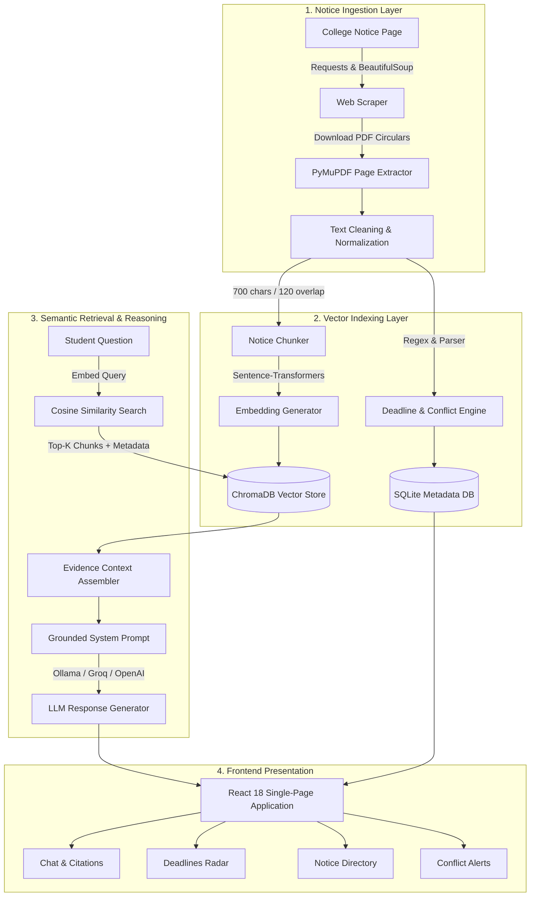

# CampusSage
### AI-Powered Web Information & Opportunity Hub
> *"Discover jobs, internships, scholarships, notices, deadlines, events, and useful information from websites in one place."*

*Active Initial Source: Government Engineering College, Ajmer (ecajmer.ac.in) —  Public Sections & Document Ingestion*

---

## 🌟 Target Institution & Website-Wide Coverage
- **Example College:** Government Engineering College, Ajmer (GEC Ajmer)
- **Official Website:** `https://www.ecajmer.ac.in/`
- **Coverage Scope:** **All 54 public sections** of the college portal:
  1. **Administration & Institutional:** Principal's Address & Vision (`/administration/PrincipalMessage`), Registrar (`/ui/cells/registrar/circulars`), Accounts Section (`/ui/cells/accounts/circulars`), Mandatory Disclosures (`/api/mandatory-disclosures/get-all`).
  2. **Examination Section:** BTU/RTU exam circulars, form filling deadlines, copy revaluation, improvement exam orders (`/ui/cells/examination-section/circulars`).
  3. **Proctor Section & Student Discipline:** Code of conduct, anti-ragging committees, campus discipline rules (`/ui/cells/proctor/circulars`).
  4. **Academic Section & Curriculum:** Academic calendar, syllabus guidelines, degree verification, migration (`/ui/cells/academic-section/circulars`, `/academics/academic-calendar`).
  5. **Academic Departments (13 Departments):** Computer Science & Engineering (CSE) and IT, Civil Engineering, Mechanical Engineering, Electrical Engineering, Electronics & Communication (ECE), Electronics Instrumentation & Control (EIC), MCA, MBA, Physics, Chemistry, Mathematics, English, Economics.
  6. **Hostels & Residential Life:** Chief Warden Office, hostel fee structure, AICTE hostel policies, room shifting orders, curfew guidelines (`/ui/cells/hostels/circulars`).
  7. **Scholarships & Financial Aid:** National Scholarship Portal (NSP), State Social Justice & Empowerment schemes, post-matric scholarships (`/ui/cells/scholarship-details/circulars`).
  8. **Central Library:** Book Bank schemes for 1st–8th sem, book issue/return rules, OPAC, reading room timings (`/ui/cells/central-library/circulars`).
  9. **Training & Placement Office (TPO) & III-Cell:** Placement guidelines, company visit notices, industrial tours (`/ui/cells/industry-institute-interaction-cell/circulars`).
  10. **Student Welfare, Clubs & Grievance Redressal:** Student Grievance Redressal Cell (SGRC), Women Cell / ICC, SC/ST/OBC Cell, Sports, NCC, NSS, AIML Club, Programming & Coding Club (PCC), ECE Club (`/ui/cells/grievance/circulars`, `/ui/cells/women-cell/circulars`, etc.).
- **Dual Ingestion Architecture:** GEC Ajmer runs a Vite/React Single-Page Application (SPA). CampusSage handles both:
  - **Descriptive Landing Overviews:** Fetches structured HTML/JSON from `/api/public/landingAbout/{slug}` across all 54 sections and indexes the official text as `content_type='webpage'`.
  - **Official Downloadable PDF Circulars:** Connects directly to `/api/circulars/public/{slug}`, downloads PDFs, and extracts text via PyMuPDF as `content_type='circular_pdf'`.
  - **Scanned Circular Preservation:** For circulars uploaded as scanned images without a text layer, CampusSage automatically preserves the verified title, circular reference number (S.No.), issue date, section, and download link, ensuring complete searchability and citation.

---

## 🌟 Project Purpose & Highlights

College circulars and academic notices are frequently published as fragmented PDF documents and web posts across different departmental notice boards. Students struggle to locate accurate, updated information regarding:
- Examination form deadlines and fee structures
- Proctor Office student discipline and anti-ragging guidelines
- Hostel fee schedules, room shifting orders, and curfew rules
- Central Library Book Bank distribution schedules
- Departmental lab practical rescheduling and mercy tests
- Scholarship application windows and eligibility criteria
- Campus placement drives and industrial visit notifications

**CampusSage** solves this problem by crawling all public college notice boards and departmental portals, extracting text from both webpage overviews and PDF circulars, chunking and embedding them into a local **ChromaDB vector database**, and answering student queries using strict **evidence-grounded retrieval**.

### ✨ Core Features
1. **Interactive Multi-Section Student Chatbot:** Natural language inquiry interface with Section Scope filtering (All College, Examinations, Hostels, Library, Proctor, CSE Dept, etc.) and streaming responses.
2. **Strict Evidence Grounding & Anti-Hallucination:** Answers are generated **only** from retrieved notice passages. If no official record contains the requested information, CampusSage explicitly alerts the student rather than guessing.
3. **Verifiable Source Citations:** Every answer displays clickable citation cards with Notice Title, Circular Reference Number, Date, Section, Content Type (`📄 PDF Circular` vs `🌐 Webpage`), and Page Number.
4. **Notice Revision & Conflict Monitor:** Detects when a college issues a postponement or revised schedule and alerts students that earlier announcements are superseded with dual-document evidence.
5. **Academic Deadlines Radar:** Automated calendar and countdown badges (Urgent ≤ 3 days, Approaching ≤ 7 days) linked directly to originating circulars, filterable by Section and Category.
6. **Searchable Notice Board:** Filter notices by Section (e.g. Hostels, Library, CSE Dept) and Department, search across all 54 sections, and preview/download circulars.
7. **54-Section Ingestion Hub:** Interactive college directory table with real-time statistics (documents indexed, vector chunks, last crawl timestamp) and 1-click "Crawl Section" buttons + "Crawl Entire Website" master action.
8. **Student Document Upload:** Drag-and-drop or upload custom PDF circulars and notice images directly from the chatbot and Ingestion Hub for instant indexing.

---

## 🏛️ System Architecture



---

## 🚀 Quick Start Guide (Run with 1 Click)

### Option 1: Double-Click the Windows Launcher
Simply double-click the included batch file:
```
E:\CampusSage_Project\run_campussage.bat
```
This automatically initializes the SQLite database, verifies ChromaDB, launches the FastAPI server at `http://127.0.0.1:8000`, and opens your web browser!

### Option 2: Run via Terminal
1. Open PowerShell or Command Prompt.
2. Navigate to the project root:
   ```powershell
   cd E:\CampusSage_Project
   ```
3. Run:
   ```powershell
   python run_campussage.py
   ```
4. Open your browser and visit: **`http://127.0.0.1:8000`**

---

## 📂 Project Structure & Explanation

```
CampusSage_Project/
│
├── backend/                         # Backend Python & AI Engine
│   ├── app/
│   │   ├── main.py                  # FastAPI entry point, CORS, and static file serving
│   │   ├── config.py                # Environment configurations (pydantic-settings)
│   │   │
│   │   ├── database/                # Relational metadata store (SQLite)
│   │   │   ├── connection.py        # SQLite connection manager and schema DDL
│   │   │   └── repository.py        # CRUD queries for notices, deadlines, and conflicts
│   │   │
│   │   ├── ingestion/               # Document collection and parsing
│   │   │   ├── sections_catalog.py  # 54 official GEC Ajmer sections registry
│   │   │   ├── pdf_processor.py     # PyMuPDF text & page extractor
│   │   │   ├── scraper.py           # Dual ingestion engine (webpages + PDFs + scanned fallback)
│   │   │   ├── sample_generator.py  # Realistic college circular & PDF generator
│   │   │   └── indexer.py           # Pipeline orchestrator indexing notices to ChromaDB
│   │   │
│   │   ├── rag/                     # RAG Core Modules
│   │   │   ├── chunker.py           # Recursive character text splitter with metadata
│   │   │   ├── embeddings.py        # Sentence-Transformers (384-dim vector space)
│   │   │   ├── vector_store.py      # ChromaDB PersistentClient & cosine similarity
│   │   │   ├── prompts.py           # Multi-section anti-hallucination system prompt
│   │   │   └── generator.py         # Grounded LLM synthesizer (Ollama/Groq/Fallback)
│   │   │
│   │   ├── intelligence/            # Analytical Intelligence
│   │   │   ├── deadline_extractor.py# Multi-section academic milestone parser
│   │   │   └── conflict_detector.py # Date revision & superseded circulars detector
│   │   │
│   │   └── routers/                 # REST API Handlers
│   │       ├── health.py            # GET /api/health
│   │       ├── chat.py              # POST /api/chat (Student Q&A with section scoping)
│   │       ├── upload.py            # POST /api/upload-pdf (Direct Circular PDF upload)
│   │       ├── notices.py           # GET /api/notices, GET /api/notices/filters, /pdf/{id}
│   │       ├── deadlines.py         # GET /api/deadlines (Filterable by section & category)
│   │       ├── conflicts.py         # GET /api/conflicts
│   │       └── ingest.py            # GET /api/ingest/sections, POST /section/{slug}, /scrape-all
│   │
│   ├── data/
│   │   ├── raw_pdfs/                # Downloaded/generated official circular PDFs
│   │   ├── chroma_db/               # Persistent ChromaDB vector storage files
│   │   └── campussage.db            # SQLite relational database
│   │
│   ├── tests/                       # Automated Pytest Suite (14 test cases)
│   │   ├── test_multi_section_coverage.py # 54 sections catalog & cross-section retrieval tests
│   │   ├── test_pdf_extraction.py   # PyMuPDF page parsing and text cleaning
│   │   ├── test_vector_store.py     # Text chunking and embeddings
│   │   ├── test_retriever.py        # Semantic similarity retrieval
│   │   ├── test_rag_pipeline.py     # Anti-hallucination and citation accuracy
│   │   └── test_upload_and_ingest_warning.py # PDF upload and ingestion warning tests
│   │
│   ├── requirements.txt             # Backend dependencies
│   └── .env.example                 # Environment configuration template
│
├── frontend/                        # Modern React User Interface
│   └── public/
│       └── index.html               # Responsive Single-Page Application (React 18 + Tailwind)
│
├── run_campussage.py                # Standalone application runner
├── run_campussage.bat               # Windows 1-click launcher
├── test_full_system.py              # 12-stage end-to-end verification suite
└── README.md                        # Project documentation
```

---

## 🧪 Automated Testing & Verification

### 1. Run Complete End-to-End System Test:
```powershell
python E:\CampusSage_Project\test_full_system.py
```
This tests all 12 critical components:
1. System Health API verification (`/api/health`)
2. Real GEC Ajmer notice scraping and ChromaDB vector indexing
3. Chatbot greeting handling ("Hey" / "Hello" / "Hi")
4. Grounded academic query answering with section citations
5. Multi-turn conversation context memory
6. Anti-hallucination safe refusal on out-of-scope questions
7. Document upload (PDF circulars and notice images)
8. Notice Board and Deadlines Radar data synchronization
9. Ingestion diagnostic warning for invalid/empty URLs
10. Multi-section catalog verification (54 college sections)
11. Section and department filtering on notices
12. Cross-section question answering across Proctor, Central Library, and Principal's message

### 2. Run Pytest Suite (14 Test Cases):
```powershell
cd E:\CampusSage_Project\backend
pytest -v
```

---

## ⚙️ Configuration & LLM Options

Settings are managed in `backend/.env`.

### 1. Local LLM via Ollama (Free, 100% Offline)
1. Install [Ollama](https://ollama.ai) on your system.
2. Pull your preferred model:
   ```bash
   ollama pull llama3:8b
   # or
   ollama pull mistral
   ```
3. In `backend/.env`:
   ```env
   LLM_PROVIDER=ollama
   OLLAMA_BASE_URL=http://localhost:11434
   OLLAMA_MODEL=llama3:8b
   ```

### 2. Free Hosted LLM via Groq API (Ultra-Fast)
Website link - https://campussage.onrender.com
---

## 🎯 Viva & Presentation Guide

### 1. Why RAG instead of Fine-Tuning or ChatGPT?
- **No Hallucinations:** Fine-tuned models still hallucinate dates. In RAG, answers are mathematically constrained to retrieved paragraphs.
- **Instant Updates:** When the college controller releases a notice at 4:00 PM, we index it into ChromaDB in 2 seconds without retraining any models.
- **Verifiable Accountability:** Students and professors can click the citation badge to inspect the original PDF page and verification signature.

### 2. How are Conflicting Notices Handled?
Colleges often release an initial notice (e.g., Nov 15 exams) and later release a postponement notice (rescheduled to Nov 22 due to youth festival). CampusSage's `ConflictDetector` compares date statements chronologically, marks earlier notices as `Superseded`, and injects an alert banner into the answer.

---

## 📄 License & Attribution
Developed for the Final-Year B.Tech Computer Science and Engineering curriculum. Designed in compliance with educational and ethical web access principles.
